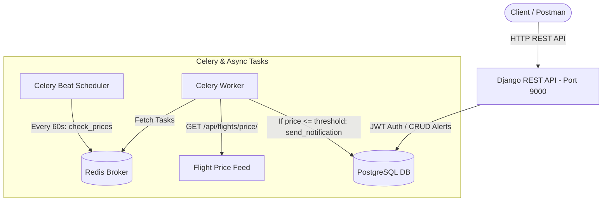

# PulseNotify ✈️🔔

PulseNotify is an asynchronous, event-driven flight price monitoring and alert notification system built using **Django REST Framework (DRF)**, **Celery**, **Redis**, and **PostgreSQL**.

The system allows users to set price alerts for flight routes. A background periodic worker queries live flight pricing and automatically logs/dispatches alerts when prices drop below the user-specified threshold.

---

## 🏗️ Architecture & Data Flow



### Flow Breakdown:
1. **API Layer (`/api/`)**: Handled by Django REST Framework with JWT authentication (`rest_framework_simplejwt`).
2. **Alert Management**: Users create and track custom route alerts (`origin`, `destination`, `threshold_price`).
3. **Periodic Scheduling (Celery Beat)**: Dispatches `pulse.tasks.check_prices` every 60 seconds into Redis.
4. **Task Execution (Celery Worker)**:
   - Polls active alerts from PostgreSQL.
   - Calls the flight price API for each distinct route.
   - Evaluates whether `current_price <= alert.threshold_price`.
   - Asynchronously dispatches `send_notification` when triggered.
   - Marks the alert as `TRIGGERED` and records an immutable log in `pulse_notificationlog`.
5. **Role-Based Access Control**: Admins have role `admin` in `UserProfile` granting exclusive access to `/api/admin/summary/`.

---

## 📁 Project Structure

```text
PulseNotify/
├── config/                     # Project configuration & settings
│   ├── settings/
│   │   ├── base.py             # Core settings, Celery & DRF config
│   │   ├── local.py            # Local development settings
│   │   └── production.py       # Production security settings
│   ├── celery.py               # Celery application initialization
│   ├── urls.py                 # Root URL configuration
│   └── wsgi.py
├── pulse/                      # Core application
│   ├── models.py               # UserProfile, PriceAlert, NotificationLog
│   ├── serializers.py          # DRF serializers (Registration, Alerts)
│   ├── views.py                # Auth, Alerts, Flight Mock, Admin Summary
│   ├── permissions.py          # IsAdminUser custom permission class
│   ├── tasks.py                # Celery tasks (check_prices, send_notification)
│   ├── signals.py              # Automatic UserProfile creation on User save
│   ├── tests.py                # Unit and integration test suite
│   └── urls.py                 # App routing
├── docker-compose.yml          # Container configuration for Redis & Postgres
├── manage.py                   # Django management script
├── postman_collection.json     # Postman collection for all 12 test scenarios
├── pyproject.toml              # Dependencies & project metadata
└── README.md
```

---

## 🛠️ Tech Stack & Dependencies

- **Language:** Python 3.13+
- **Web Framework:** Django 6.1 + Django REST Framework
- **Authentication:** SimpleJWT (JSON Web Tokens)
- **Task Queue & Scheduler:** Celery + Celery Beat
- **Message Broker:** Redis
- **Database:** PostgreSQL (production / local)
- **HTTP Client:** Requests

---

## 🚀 Getting Started

### 1. Prerequisites
Ensure you have the following installed and running:
- Python 3.12 or 3.13
- PostgreSQL
- Redis Server (or via Docker: `docker compose up -d`)

### 2. Environment Setup
Create a `.env` file in the project root:
```env
DJANGO_SETTINGS_MODULE=config.settings.local
SECRET_KEY=your-secure-secret-key-here
DB_NAME=pulsenotify
DB_USER=pulseuser
DB_PASSWORD=pulse_dev_password
DB_HOST=localhost
DB_PORT=5432
CELERY_BROKER_URL=redis://localhost:6379/0
CELERY_RESULT_BACKEND=redis://localhost:6379/0
ALLOWED_HOSTS=localhost,127.0.0.1
```

### 3. Install Dependencies & Run Migrations
```bash
# Activate virtual environment
.\.venv\Scripts\activate   # Windows
# source .venv/bin/activate # Linux/macOS

# Apply migrations
python manage.py migrate
```

---

## ⚙️ Running the System

You need three terminal processes running concurrently:

### Terminal 1: Django API Server
```bash
python manage.py runserver 9000
```

### Terminal 2: Celery Worker
```bash
# On Windows, use --pool=solo
celery -A config worker --loglevel=info --pool=solo

# On Linux/macOS
celery -A config worker --loglevel=info
```

### Terminal 3: Celery Beat (Scheduler)
```bash
celery -A config beat --loglevel=info
```

---

## 📡 API Endpoints Reference

| # | Endpoint | Method | Auth | Description |
|---|---|---|---|---|
| 1 | `/api/auth/register/` | `POST` | None | Register new user; returns JWT access token |
| 2 | `/api/auth/login/` | `POST` | None | Authenticate; returns JWT access token & user role |
| 3 | `/api/alerts/` | `GET` | Bearer Token | List all alerts belonging to the authenticated user |
| 4 | `/api/alerts/` | `POST` | Bearer Token | Create an alert (`origin`, `destination`, `threshold_price`) |
| 5 | `/api/alerts/<id>/` | `DELETE` | Bearer Token | Deactivate an alert |
| 6 | `/api/flights/price/?route=<R>` | `GET` | None | Mock flight price feed (e.g. `DEL-BOM`, `BLR-HYD`) |
| 7 | `/api/admin/summary/` | `GET` | Admin Token | Metrics: active/triggered alerts, notifications & top routes |

---

## 🧪 Testing & Postman Collection

### 1. Django Automated Tests
Run unit tests verifying models, permissions, scoping, and threshold evaluation:
```bash
python manage.py test
```

### 2. Postman Collection
The file [`postman_collection.json`](./postman_collection.json) is pre-configured with all 12 validation scenarios.

To run via Newman CLI:
```bash
npx -y newman run postman_collection.json
```
All 12 scenarios (24 assertions) will execute and pass against `http://127.0.0.1:9000`.

### 3. Verifying Asynchronous Notifications in PGAdmin (Scenario 13)
To verify background Celery execution:
1. Open **PGAdmin** and connect to the `pulsenotify` database.
2. Open the Query Tool and run:
   ```sql
   SELECT * FROM pulse_notificationlog;
   ```
3. A row will be visible with `triggered_price`, `message`, and timestamp when Celery processes an alert whose threshold condition was satisfied.
